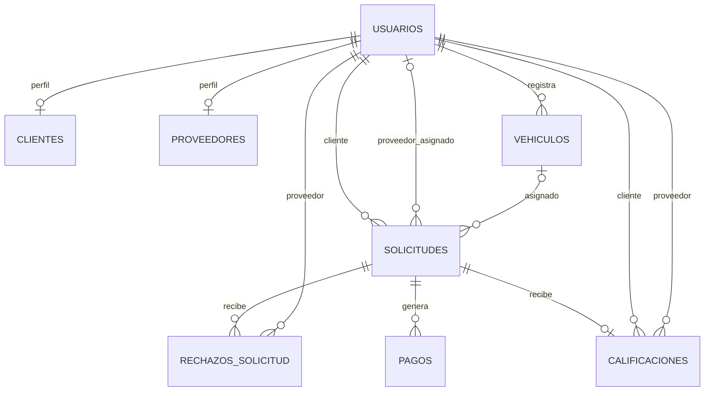

# Modelo relacional de MudGo

El esquema SQL define las entidades necesarias para los procesos representados en el prototipo y la primera API.

| Tabla | Propósito | Relaciones principales |
|---|---|---|
| `usuarios` | Credenciales, datos personales, rol y estado | Tabla central de clientes, proveedores y administradores |
| `clientes` | Datos complementarios del cliente | `usuario_id` → usuarios |
| `proveedores` | Disponibilidad y datos del prestador | `usuario_id` → usuarios |
| `vehiculos` | Vehículos registrados por proveedores | `proveedor_id` → usuarios |
| `solicitudes` | Datos de traslado, cotización y estado | Cliente, proveedor y vehículo |
| `rechazos_solicitud` | Proveedores que rechazaron una solicitud | Solicitud y proveedor |
| `pagos` | Intentos y resultado del pago | Solicitud y cliente |
| `calificaciones` | Valoración del servicio terminado | Solicitud, cliente y proveedor |

## Reglas de negocio modeladas
1. Una solicitud pertenece a un cliente.
2. Una solicitud puede no tener proveedor asignado mientras se encuentra en búsqueda.
3. La solicitud solo pasa a `aceptada` cuando un proveedor disponible la acepta.
4. El pago se registra únicamente cuando la solicitud está en estado `aceptada`.
5. Un servicio solo puede calificarse cuando está `finalizada`.
6. Cada solicitud admite una única calificación.
7. El registro público permite los roles cliente y proveedor; el administrador se crea mediante una operación controlada.

## Diagrama ER (Mermaid)

La estructura física se encuentra en `database/mudgo.sql`. Este modelo se debe ajustar si, durante la integración del frontend, se identifican atributos adicionales obligatorios.
